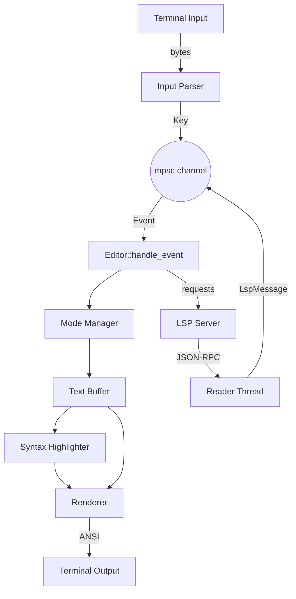

<div align="center">

# nuta

**Nimble Unix Text Architect**

A minimal, modal terminal code editor written from scratch in Rust.


</div>

---

## Overview

**nuta** is a Vim-inspired terminal editor built to be small enough to understand completely.
The entire TUI layer is hand-written: raw mode, screen buffer, ANSI rendering, and key parsing.
The only `unsafe` code is isolated in the terminal module — everything above it is safe Rust.

Named after a musical note (*nuta*), and backronymed into **N**imble **U**nix **T**ext **A**rchitect.

> ⚠️ **Early development.** Daily-drivable for small edits, but expect rough edges.
> See [Limitations](#limitations) before relying on it.

---

## Features

| | Feature | Status |
|---|---|---|
| 🎹 | Modal editing — Normal / Insert / Visual | ✅ |
| 🖥️ | Hand-written TUI engine (ANSI + termios) | ✅ |
| 🌍 | Full UTF-8 input (Cyrillic, CJK, emoji) | ✅ |
| 🎨 | Catppuccin Mocha theme, mode-colored status bar | ✅ |
| 🔦 | Regex syntax highlighting via TOML configs | ✅ |
| 🗂️ | Built-in file explorer + multi-buffer support | ✅ |
| 🔌 | LSP client — real-time diagnostics | ✅ |
| 📖 | Built-in scrollable help screen | ✅ |
| ⚙️ | TOML configuration with sane defaults | ✅ |
| 🧵 | Event-driven async core (no UI freezing) | ✅ |
| ↩️ | Undo / yank / paste | ✅ |
| 🤖 | Local LLM integration (llama.cpp) | 🚧 planned |
| 🔍 | Search (`/`), completion popup, goto-definition | 🚧 planned |
| 🌙 | Lua plugin system | 🚧 planned |

---

## Installation

### Requirements

- Rust 1.70+ (`rustup` recommended)
- A POSIX terminal (Linux, macOS, or WSL) or Windows 10/11
- A terminal with truecolor support for the intended palette

### Build

```bash
git clone https://github.com/Mihailov2409/nuta.git
cd nuta
cargo build --release
```

The binary lands at `target/release/nuta`. Optionally install it:

```bash
cargo install --path .
```

### Run

```bash
nuta                 # empty buffer
nuta src/main.rs     # open a file
nuta new_file.py     # create a file
```

On first launch, a default config is written to `~/.config/nuta/config.toml`.

---

## Keybindings

Press <kbd>?</kbd> in Normal mode for the built-in help screen.

### Normal

| Key | Action |
|---|---|
| `h` `j` `k` `l` / arrows | Move cursor |
| `w` `b` `e` | Next word / previous word / end of word |
| `0` `$` | Line start / line end |
| `gg` `G` | File start / file end |
| `PgUp` `PgDn` | Page up / down |
| `i` `a` `I` `A` | Insert before / after / line start / line end |
| `o` `O` | New line below / above |
| `x` | Delete character |
| `dd` `yy` `p` | Delete line / yank line / paste |
| `u` | Undo |
| `v` | Visual mode |
| `:` | Command line |
| `?` | Help |

### Insert

| Key | Action |
|---|---|
| `Esc` | Back to Normal |
| `Tab` | Insert spaces (soft tabs) |
| `Enter` `Backspace` `Delete` | Standard editing |
| arrows `Home` `End` | Navigation |

### Visual

| Key | Action |
|---|---|
| motions | Extend selection |
| `d` / `x` | Cut selection |
| `y` | Yank selection |
| `Esc` | Cancel |

### Global

| Key | Action |
|---|---|
| `Ctrl+S` | Save |
| `Ctrl+Q` | Quit |

### Commands

| Command | Action |
|---|---|
| `:w [path]` | Save (optionally as a new path) |
| `:q` / `:q!` | Quit / force quit |
| `:wq` / `:x` | Save and quit |
| `:e <path>` | Open file in a new buffer |
| `:Ex` | File explorer |
| `:ls` | List buffers |
| `:bn` / `:bp` | Next / previous buffer |
| `:bd` / `:bd!` | Close buffer / force close |
| `:syntax` | Highlighting stats (languages, rules) |
| `:lsp` | Language server status |
| `:help` / `:h` | Help screen |

### Explorer

| Key | Action |
|---|---|
| `j` / `k` | Move selection |
| `Enter` | Open file or directory |
| `-` | Parent directory |
| `q` / `Esc` | Close |

---

## Configuration

Config lives at `~/.config/nuta/config.toml` (respects `XDG_CONFIG_HOME`).
Missing fields fall back to defaults, so partial configs are fine.

```toml
[editor]
tab_width = 4
line_numbers = true

[theme]
name = "catppuccin-mocha"

[syntax]
enabled = true

[lsp.rust]
command = "rust-analyzer"
args = []

[lsp.python]
command = "pyright-langserver"
args = ["--stdio"]

[lsp.c]
command = "clangd"
args = []

[lsp.cpp]
command = "clangd"
args = []

[lsp.asm]
command = "asm-lsp"
args = []

[ai]
enabled = false
llama_bin = "llama-cli"
model = ""
```

---

## Syntax Highlighting

Highlighting is **regex-based, offline, and independent of LSP**.
Five languages ship built in: **Python, C, C++, Rust, Assembly**.

### Custom languages

Drop a TOML file into `~/.config/nuta/syntax/`. User definitions load after built-ins,
so you can override an existing language or add your own.

```toml
name = "MyLang"
extensions = ["my", "mylang"]

[[rule]]
regex = '#.*$'
group = "Comment"

[[rule]]
regex = '\b(if|else|while|return)\b'
group = "Keyword"

[[rule]]
regex = '"[^"]*"'
group = "String"

# Capture groups let you match context without coloring it.
# Here only the function name is colored, not the paren.
[[rule]]
regex = '\b([A-Za-z_][A-Za-z0-9_]*)\('
group = "Function"
capture = 1
```

### Highlight groups

Group names follow Vim conventions to ease porting existing colorschemes:

`Comment` · `String` · `Number` · `Keyword` · `Type` · `Function` · `PreProc` · `Special` · `Macro` · `Label` · `Register` · `Operator`

### Porting Vim syntax files

Full Vimscript compatibility is **not** implemented. Simple rules map cleanly:

```vim
syn keyword myKeyword hello world
hi def link myKeyword Keyword
```

```toml
[[rule]]
regex = '\b(hello|world)\b'
group = "Keyword"
```

---

## Language Servers

nuta speaks LSP over stdio. Install the servers you need:

| Language | Server | Install |
|---|---|---|
| Rust | `rust-analyzer` | `rustup component add rust-analyzer rust-src` |
| Python | `pyright` | `npm install -g pyright` |
| C / C++ | `clangd` | `apt install clangd` / `pacman -S clang` |
| Assembly | `asm-lsp` | `cargo install asm-lsp` |

**Currently implemented:** diagnostics (underline + colored line numbers + message under cursor).

Diagnostics refresh when you leave Insert mode, not on every keystroke — this keeps typing smooth.

Check status anytime with `:lsp`:

```
LSP: running | lang: rust | ready: yes | diag: 3 | ver: 7
```

---

## Architecture

Event-driven core. Input and language servers run on separate threads and feed a single
event channel, so the UI never blocks on I/O.



### Project layout

```
src/
├── main.rs              # entry point, event loop
├── config.rs            # TOML config + defaults
├── event.rs             # Event enum
├── lsp.rs               # LSP client (JSON-RPC over stdio)
├── theme.rs             # Catppuccin Mocha palette
├── terminal/            # hand-written TUI engine
│   ├── raw_mode.rs      # RAII termios guard
│   ├── buffer.rs        # screen, ANSI output, cursor shapes
│   └── input.rs         # poll-based key parsing, UTF-8
├── editor/
│   ├── mod.rs           # modes, commands, rendering
│   ├── buffer.rs        # text buffer, cursor, motions
│   └── modes.rs         # Normal / Insert / Visual
└── syntax/
    ├── mod.rs           # regex highlighter
    └── languages/       # built-in TOML definitions
```

### Design notes

- **`unsafe` is quarantined** to `terminal/`. Editor logic is entirely safe Rust.
- **Cursor columns are char indices, not byte indices** — required for correct UTF-8 editing.
- **Display width uses `unicode-width`** so wide glyphs don't desync the cursor.
- **Rendering is segment-based**, which made syntax highlighting and selections additive
  rather than requiring a rewrite.
- **RAII guards** restore the terminal on exit *and* on panic.

---

## Limitations

Known and accepted for now:

- **No horizontal scrolling** — long lines are truncated at the viewport edge.
- **Line-based highlighting** — multi-line block comments and triple-quoted strings
  are not tracked across lines.
- **Snapshot undo** — simple and correct, but memory-hungry on very large files.
- **Soft tabs only** — `Tab` inserts spaces.
- **No search yet** (`/` is planned).
- **LSP is diagnostics-only** — completion, hover, and goto-definition are not wired up.
- **Native Windows is unsupported** (see below).

---

## Platform Support

| Platform | Status |
|---|---|
| Linux | ✅ Supported |
| macOS | ✅ Supported |
| WSL / WSL2 | ✅ Supported |
| Windows (native) | ✅ Supported |

---

## Roadmap

- [x] Modal editing, UTF-8, undo
- [x] TOML config + regex highlighting
- [x] File explorer + multi-buffer
- [x] Event-driven async core
- [x] LSP diagnostics
- [ ] `didChange` debounce + per-buffer LSP state
- [ ] Search (`/`, `n`, `N`)
- [ ] Completion popup + goto-definition
- [ ] Horizontal scrolling
- [ ] Multi-line syntax regions
- [ ] Local LLM assistant (`:ai explain`, `:ai refactor`) via llama.cpp
- [ ] Lua plugin API
- [x] Windows backend

---

## Contributing

This is a learning project built in the open. Issues, ideas, and PRs are welcome —
especially around the terminal layer and LSP correctness.

```bash
cargo check     # fast feedback loop
cargo run -- src/main.rs
```

---

## License

MIT — see [LICENSE](LICENSE).

---

<div align="center">

Built one escape sequence at a time.

</div>
